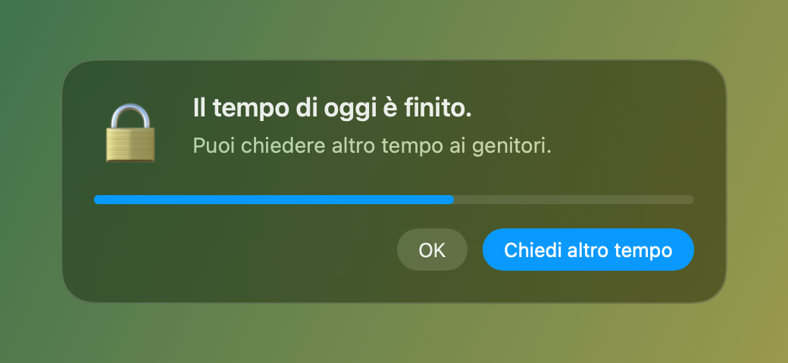

# FamilyTimer

A daily screen-time limit for a child's Mac, with extra time approved by the parents on
Telegram. Native Swift, no subscription, no cloud service of its own, no network filtering.

## What it does

- **Daily budget of active time** per child account, with separate weekday and weekend
  limits. Time counts only while the child is actually using the Mac (keyboard or mouse in
  the last 2 minutes), and the counter resets at midnight.
- **Warnings** at 5 minutes and 1 minute before the end, and a countdown in the menu bar.
- **Ask for more time.** When the time is over the child gets 5 minutes of grace and a window
  with *Ask for more time*. The request reaches the parents' Telegram group with **Approve**
  and **Deny** buttons. The child can ask again from the lock screen: after unlocking, a small
  window offers the button for 15 seconds before the screen locks again. After a *no*, no
  more requests until midnight.
- **Real lock.** When the time is over the screen locks, and locks again within seconds if the
  child unlocks it. If the menu bar app is missing or killed, the root daemon notices that the
  screen stays unlocked and logs the child out.
- **Parent commands** in the Telegram group: `/status`, `/extra 30`, `/studio 2h` (homework:
  time does not count), `/lock`, `/unlock`, `/app` and `/oggi` (time per app and per site).
  With several children, one bot per Mac in the same group, and commands take the child's
  name: `/extra 15m art`.
- **Usage per app and per site** (in progress): the last 7 days or today, with buttons to sort
  each app or site into games, study, video or other. Sites need the macOS Accessibility
  permission. No rules on categories yet.
- **Self-healing.** If the menu bar app is switched off in Login Items or quits, the daemon
  starts it again and tells the parents when it cannot. A heartbeat to
  [Healthchecks.io](https://healthchecks.io) tells the parents when a Mac stops reporting.
- **Italian and English** for every text the child and the parents see (`LANGUAGE=it`).

## How it works

| Part | Runs as | Job |
|---|---|---|
| `familytimerd` | root, LaunchDaemon | The authority: counts active time, keeps the state, talks to Telegram and Healthchecks, decides when to lock, checks the lock by itself, logs the child out as a last resort |
| `FamilyTimerAgent` | the child, LaunchAgent | The face: menu bar countdown, warnings, the windows, the screen lock |
| `FamilyTimerCore` | library | Pure logic with no system calls (config, commands, policy state machine, usage log, texts), fully unit-tested |

The daemon never trusts the agent for anything that matters: it reads the console user, the
idle time and whether the screen is locked from the system, and accepts agent connections
only from the child's uid. The child account must be a **standard** user: with an
administrator password every local control can be removed.

The design, the rules and their reasons are in [docs/SPEC.md](docs/SPEC.md).

## Requirements

- macOS 13 or later on the child's Mac (tested on macOS 26 and 27), Apple silicon or Intel.
- A Mac with Swift 5.9 or later (Xcode or the command line tools) to build.
- A Telegram account for each parent. Optional: a free Healthchecks.io account.

## Setup

### 1. Telegram

1. In Telegram, talk to **@BotFather** (the real one, with the blue check), send `/newbot`
   and keep the token. One bot per child's Mac.
2. Create a group with both parents and add the bots. Make the bots group admins (or turn off
   their privacy mode with `/setprivacy` in BotFather), so they see every command.
3. Send a message in the group, then open
   `https://api.telegram.org/bot<TOKEN>/getUpdates`: `chat.id` (a negative number) is
   `TELEGRAM_CHAT_ID`, each parent's `from.id` goes in `PARENT_USER_IDS`.

Treat the token as a password: whoever has it can grant time.

### 2. Config

One file per child's Mac, `KEY=VALUE`, never committed:

    CHILD_USER=arthur
    CHILD_NAMES=Art,arthur
    LANGUAGE=en
    TIME_LIMIT=3600
    WEEKEND_TIME_LIMIT=3600
    TELEGRAM_BOT_TOKEN=123456:ABC...
    TELEGRAM_CHAT_ID=-100123456789
    PARENT_USER_IDS=111111,222222
    HEALTHCHECK_URL=https://hc-ping.com/...

Times are in seconds. All keys and defaults (grace time, request timeout, idle threshold...)
are in [docs/SPEC.md](docs/SPEC.md#5-configuration).

### 3. Install

**On the children's Macs over SSH** (the way it is used here): put the config in
`~/.config/familytimer/NAME.env` with `HOST=admin@the-mac` on top, then

    bin/deploy NAME

It builds for the target's CPU, signs, copies and installs as root. The first run asks for
the admin password once; later deploys need none. [docs/DEPLOY.md](docs/DEPLOY.md) explains
every step, the files on the Mac, signing, the Accessibility permission and troubleshooting.
Start with `DRY_RUN=1` in the env file: the daemon then logs instead of locking or logging out.

**On the Mac you are using**, from an administrator account:

    swift build -c release
    mkdir -m 700 ~/ft-stage
    cp .build/release/familytimerd .build/release/FamilyTimerAgent deploy/update ~/ft-stage/
    cp my-config ~/ft-stage/config
    sudo bash ~/ft-stage/update ~/ft-stage

The updater also adds a sudoers rule that lets that admin run only the updater without a
password.

### 4. Sites (optional)

On each child's Mac, an admin turns on **FamilyTimerAgent** in System Settings › Privacy &
Security › Accessibility (the agent adds itself to the list). Until then only apps are
recorded and the parents get a reminder at most once a day.

## Development

    swift build && swift test

The pure logic lives in `Sources/FamilyTimerCore` and is covered by XCTest; time and calendar
are always parameters. Part of it was written by a local model from the task cards in
[docs/tasks](docs/tasks) and reviewed before each commit; [AGENTS.md](AGENTS.md) holds the
rules for that model, [CLAUDE.md](CLAUDE.md) points a supervising session to the docs.
`tools/spike0s1.swift` checks that locking works on a new macOS version.

The shell scripts at the top level (`minertimer.sh`, `install_minertimer.sh`, ...) are the
original minecraft-timer, kept for reference; FamilyTimer does not use them.

## Credits

A fork of [minecraft-timer](https://github.com/linaspurinis/minecraft-timer) by Linas
Purinis, itself based on [minertimer](https://github.com/soferio/minertimer) by Soferio Pty
Limited. From minecraft-timer it keeps the idea, the Telegram approval flow and the config
format; the code is rewritten in Swift and extended from Minecraft to the whole Mac.

## License

MIT, see [LICENSE](LICENSE).
